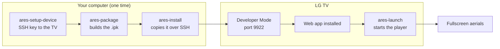
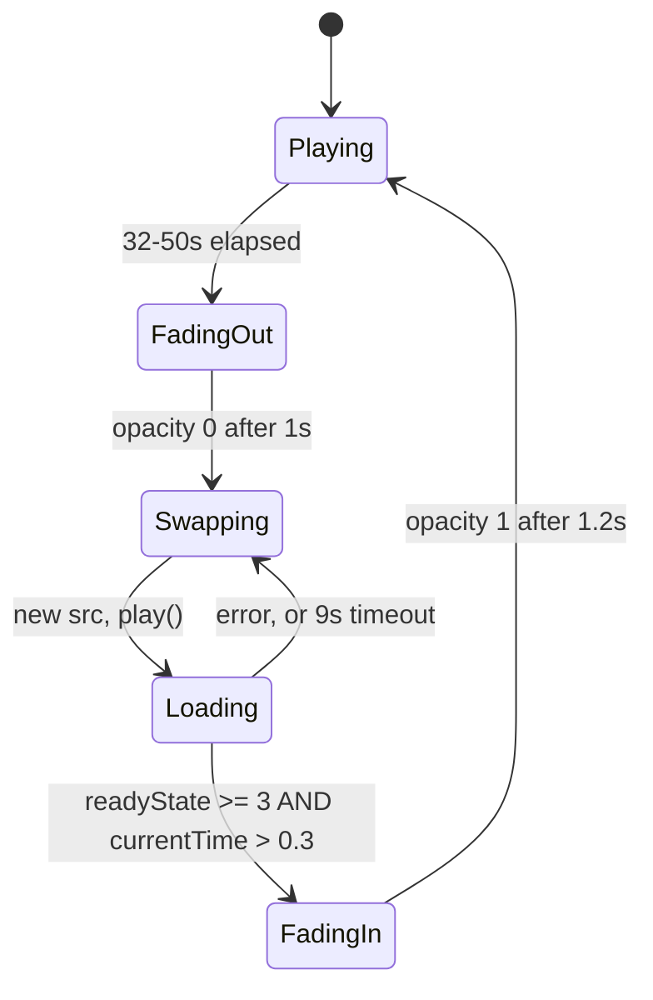
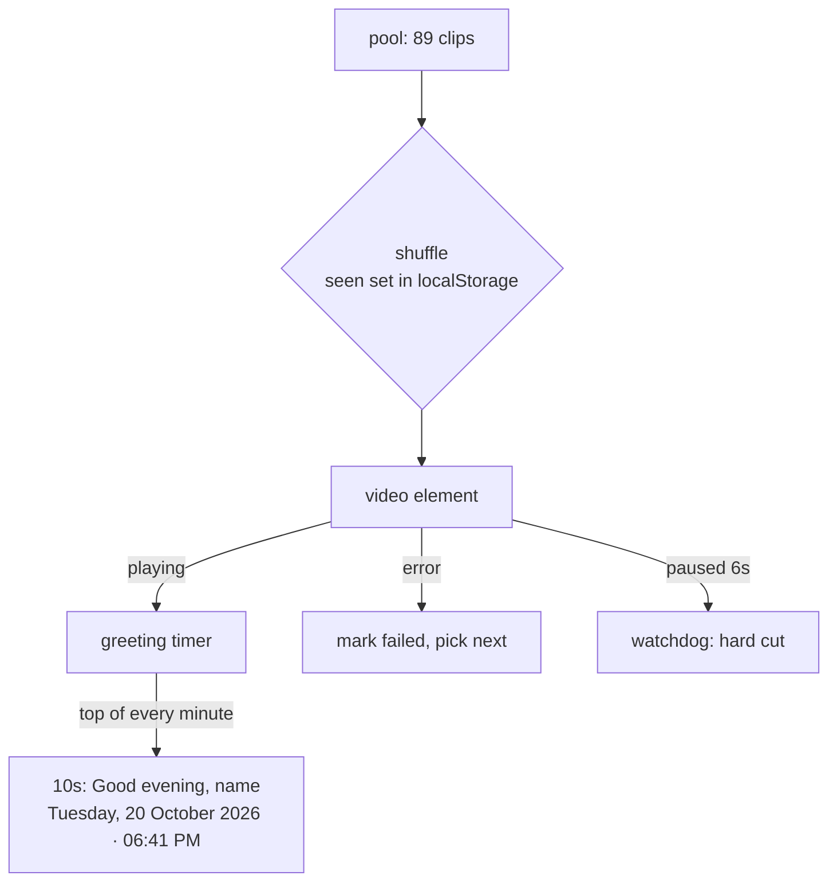

# Aerial TV

**Turn your idle LG TV into a window.**

89 aerial clips. 4K. Dip-to-black transitions. A quiet greeting that tells you the
time, the date, and says good evening.

No build step, no dependencies, no framework — one HTML file and a list of URLs,
packaged as a webOS app.

---

## Why

LG's built-in screensaver is a clock and a photo frame. Apple TV's aerials are the
benchmark everyone points at, and there is no supported way to get them onto webOS.

This is that, packaged as a plain webOS app (~15 KB of code):

- **4K HEVC aerials**, streamed — nothing bundled, nothing downloaded to disk
- **Dip to black** between shots, with the outgoing clip still playing as it fades
- **The next clip only fades in once it is moving** — no frozen first frame
- **89 clips**, shuffled, no repeats until the whole library has played
- **Greeting**: "Good evening" + your name, day, date and clock, 10s every minute
- **Self-healing**: dead source → skip, stalled video → replace

---

## Requirements

| | |
|---|---|
| TV | LG webOS TV with **Developer Mode** enabled |
| Mac/Linux | Node.js 18+, `@webos-tools/cli` |
| Network | TV must reach the video CDN |

---

## Install

```bash
npm i -g @webos-tools/cli
ares-setup-device                # host, port 9922, user prisoner, SSH key

ares-package . -o dist
ares-install -d <device> dist/com.example.aerialtv_*_all.ipk
ares-launch  -d <device> com.example.aerialtv
```



The app id com.example.aerialtv is a placeholder - change it in appinfo.json to your own namespace before installing, so it cannot collide with another build.

The tile appears in the launcher **after the next TV restart** — the launcher
builds its grid at boot.

---

## How it works

One `<video>` element, deliberately. Two would be a crossfade, and this panel
cannot decode two 4K streams at once — that was the bug that made earlier
versions stall on every cut.





### The details that matter

- **No repeats.** Played URLs go into a `seen` set; when every clip has played,
  the set clears and the pool reshuffles. A session is a different order each time.
- **The fade-in gate.** `currentTime > 0.3s` is what separates "a video that is
  running" from "a poster frame that happens to be loaded".
- **Greeting cadence.** Pinned to the top of each minute, not to app start, so it
  never drifts.

---

## Personalise

**Your name** — `index.html`, one line:

```js
var NAME = '';       // -> "Good evening"
var NAME = 'Sam';    // -> "Good evening, Sam"
```

**Your footage** — `sources.js`:

```js
var AERIALS = [ { t: 'Dubai', u: 'https://example.com/clip.mp4' } ];
var FREE    = [];  // used only when AERIALS is empty
```

**Timing** — `scheduleNext()` in `index.html`:

```js
var seg = 32 + Math.random() * 18;   // 32-50 seconds per shot
```

---

## Troubleshooting

| Symptom | Cause |
|---|---|
| Tile missing from launcher | Launcher caches at boot — restart the TV |
| Black screen, no video | CDN unreachable from the TV; check `curl` from the TV shell |
| Frozen frame at a cut | The next clip never reached `play()`; watch the 9s timeout path |
| App won't come to front | Set `handlesRelaunch: false` in `appinfo.json` |
| 4K stutters | Bandwidth; 4K HEVC needs ~20-40 Mb/s sustained |

---

## Limitations

- **This is an app, not a system screensaver.** webOS has one screensaver slot
  (`com.webos.app.screensaver`), in read-only `/usr/palm`; replacing it needs root.
  You launch Aerial TV yourself, and while it plays the TV will not dim.
- **No offline caching.** Every clip is streamed.
- **No HDR.** The SDR variants are used deliberately.

---

## Credits

**Footage** — the 89 clips are Apple's TV aerial videos, streamed from Apple's
CDN. The URLs come from community indexes of Apple's own public manifest:

- [dmn001/apple_tv_screensaver_downloader](https://github.com/dmn001/apple_tv_screensaver_downloader) — `entries.json` and the `resources-13.tar` bundle
- Apple's `sylvan.apple.com/Aerials/resources-13.tar`

No video is bundled or redistributed here — `sources.js` only lists URLs. **The
footage is not MIT-licensed and is not covered by this project's licence.** If you
publish a fork or use this commercially, replace the list with footage you have
rights to.

**Inspiration** — Apple TV's aerial screensavers, and
[JohnCoates/Aerial](https://github.com/JohnCoates/Aerial) for proving the format
was worth chasing. No code from Aerial is used; this is a separate webOS
implementation.

**REA** — [morluto/rea](https://github.com/morluto/rea), the reverse-engineering
MCP toolkit whose public documentation framed the approach used here to map the
TV's undocumented APIs. No REA code is used by this app.

**Packaging** — [@webos-tools/cli](https://www.npmjs.com/package/@webos-tools/cli)
by LG Electronics.

**Code** — all of it is in `index.html` and `sources.js`. No third-party
JavaScript, no frameworks, no build tools.

---

## See also

[webos-tv-mcp](https://github.com/taljeri/webos-tv-mcp) - drive the same TV from an
agent or the terminal: status, apps, launch, volume.

## Licence

MIT for the code — see [LICENSE](LICENSE).
The aerial footage is Apple's and is **not** covered by that licence.
